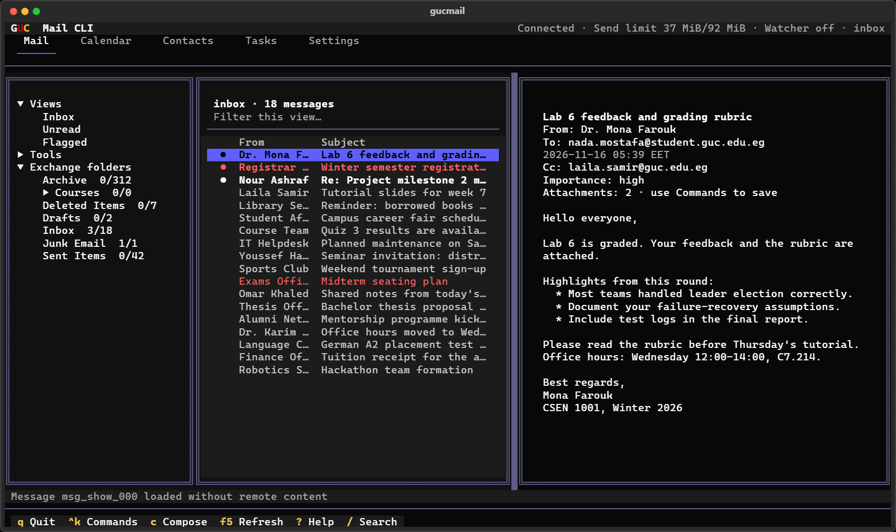
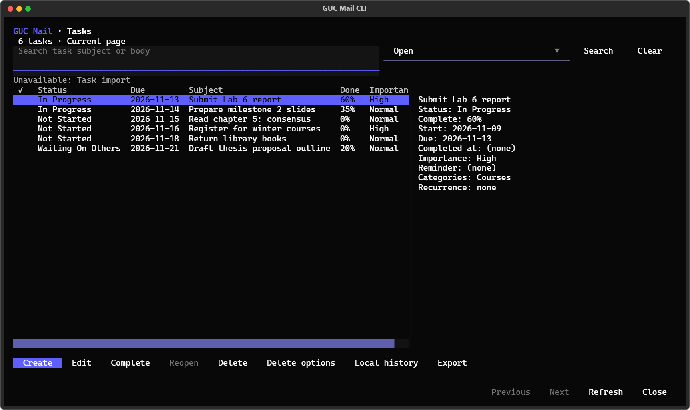
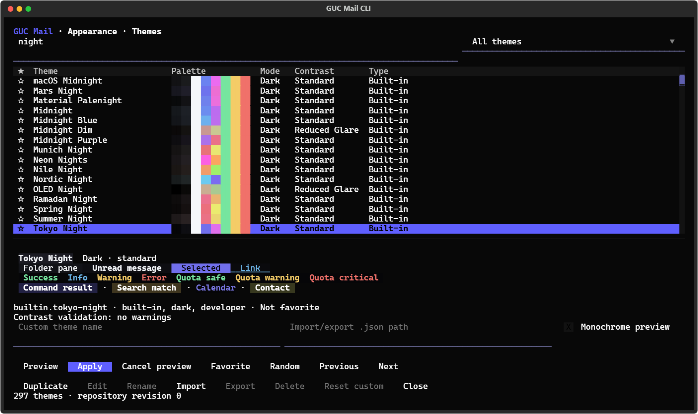
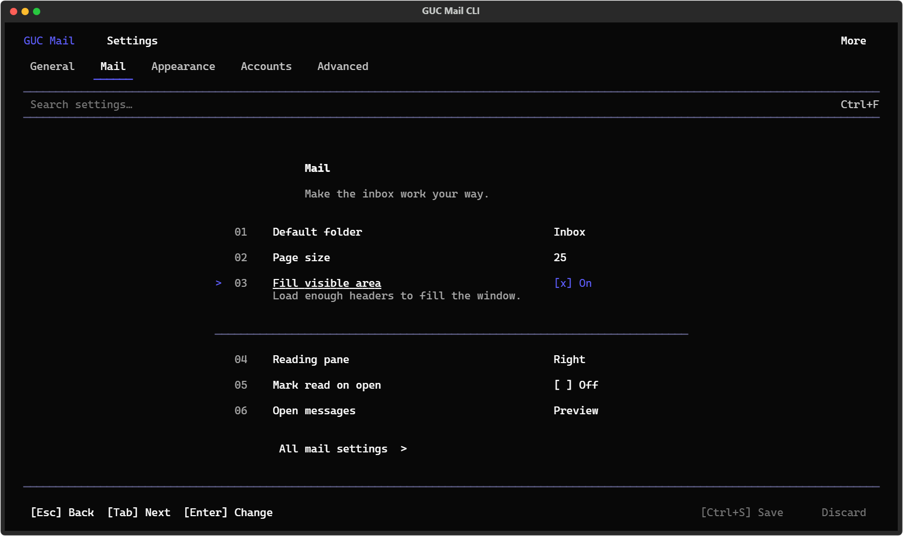

# gucmail

Your GUC mailbox, in a terminal. Read, write, search, schedule and back up your mail without
opening Outlook on the web. Calendar, contacts and tasks come along too. Everything works from
the keyboard, and everything is scriptable.


It talks directly to the GUC Exchange server through Exchange Web Services (EWS), the same
interface Outlook uses, so there's nothing to install on the server and no third-party cloud in
between. Your password stays in Windows Credential Manager, and your mail stays on your machine:
gucmail fetches headers in small pages, loads a message only when you open it, and keeps a local
cache and search index you can wipe at any time.

It was made for GUC, but nothing in it is GUC-only. It works with any Exchange server that
offers EWS with a username and password, which covers most on-premises Exchange 2013–2019
installations. Point it at yours with `gucmail config set endpoint https://mail.example.edu/EWS/Exchange.asmx`.
Microsoft 365 isn't supported, because it only allows OAuth sign-in.

*This is an independent project. I am not affiliated with the German University in Cairo or Microsoft.*

## Install

You need Python 3.11 or newer. [pipx](https://pipx.pypa.io) installs gucmail in its own
environment and puts the `gucmail` command on your PATH:

```powershell
py -m pip install --user pipx
py -m pipx ensurepath                 # then open a new terminal
pipx install "gucmail[desktop]"
gucmail login                         # asks for your GUC password, stores it in Windows Credential Manager
gucmail tui                           # opens the full-screen interface
```

Update with `pipx upgrade gucmail`. Plain `pip install "gucmail[desktop]"` works too.
Leave out `[desktop]` if you don't want Windows notifications.

## Get around



Arrows move. **Enter** opens. **Tab** jumps between panes. **c** composes, **r** replies,
**/** searches and **?** shows every shortcut. Mouse and scroll wheel work too.

**Ctrl+K** opens the command palette. Type what you want in plain words:


It shows exactly what it understood (*Schedule current draft · tomorrow at 9:00*) and asks
before it does anything. It never guesses at deleting.

## Write


Reply, reply-all and forward. Cc and Bcc, attachments, signatures and importance. Recipients
autocomplete from your contacts and recent mail. It warns you about an empty subject, a missing
attachment you mentioned ("see attached…") or a typo in an address.

Drafts save themselves, and if your laptop dies mid-sentence, the draft is waiting next time.
**Undo Send** holds a message for a few seconds before it leaves.

## Send later


```powershell
gucmail send --to ta@example.edu --subject "Lab 6" --body-file report.txt --at "Monday 8:30"
gucmail send --to me@example.edu --subject "Reminder" --body "Submit thesis" --in "2 hours"
gucmail scheduled list
```

It always shows the exact time and time zone before queuing, refuses ambiguous dates like
`03/04`, and never sends anything twice. It handles Cairo's daylight-saving switch. Messages
go out from your PC, so it needs to be on. A Windows task can take care of that
([how](https://github.com/aynader/gucmail/blob/main/docs/scheduling/windows-task-scheduler.md)).

## Calendar, contacts, tasks


Day, week, month and agenda views. Create events, accept or decline meetings, find a free
slot, catch clashes, and import or export `.ics` files.

| Contacts | Tasks |
|---|---|
|  |  |

Contacts find duplicates and merge them, and import and export vCards. Tasks have due dates,
progress and repeats.

## Search

```powershell
gucmail search --sender "dr. mona" --after 2026-10-01 --has-attachments
gucmail search "rubric" --all-folders
gucmail index build --include-bodies             # build a local full-text index once…
gucmail search --local --fuzzy "gradng rubrik"   # …then search it offline, typos and all
```

Saved searches, per-folder or whole-mailbox scope, and a search box in every view.

## Notifications, even with the terminal closed

A small background watcher checks your Inbox about once a minute and shows a Windows toast
for new mail. It runs as a Windows task that starts when you sign in, with no window and no
terminal. Clicking a toast opens the message.

In the interface: press **Ctrl+K** and open **notification settings**.

1. Choose **New / setup** to create a monitoring profile for your Inbox, then **Enable** it.
2. Under **Providers & Privacy**, choose **Desktop setup…**, then **Add provider → Desktop**.
3. Go to **Settings**, search for **start**, and choose **Start monitoring with Windows →
   Open setup**. Your active profile is filled in. Press **Enable…** and monitoring starts
   straight away, then again every time you sign in.

Or from the command line:

```powershell
gucmail notifications profiles create primary --name "Inbox" --enabled --activate
gucmail notifications desktop setup --apply          # lets Windows show gucmail toasts
gucmail startup enable --profile primary --apply     # the background task
```

The Desktop provider is added in the interface, as above. Quiet hours, rules ("only mail
from @guc.edu.eg with 'exam' in the subject") and signed webhooks are optional.
[Details](https://github.com/aynader/gucmail/blob/main/docs/monitoring/headless-deployment.md).

## Backups you can read without a connection


```powershell
gucmail backup create --encrypt          # full backup, password-protected
gucmail backup incremental               # just what changed since
gucmail backup browse <id>               # read it offline, even with Wi-Fi off
gucmail tui --offline                    # or browse cached mail in the interface
```

Backups never mark anything read and never change the server. Restores are planned first,
with exact counts, and you confirm before anything is written.

## Make it yours



More than 600 themes with live preview, and your own colours or logo. Choose your columns,
layouts and keyboard shortcuts in Settings, which you can search.



## Scripts and automation

Every command has `--json` (one envelope) or `--ndjson` (one record per line), stable exit
codes, `--yes` for confirmations and `--dry-run` for anything that changes mail.

```powershell
gucmail --json messages list --folder inbox --limit 5
gucmail --ndjson search --unread | ConvertFrom-Json | ? type -eq item | % { $_.data.subject }
gucmail --yes messages move msg_12 msg_13 --to "Courses/Distributed Systems"
gucmail quota                              # how full your mailbox is
gucmail doctor                             # checks everything, offline unless you ask
```

There's more under `gucmail --help`: rules, automatic replies, insights ("who fills my
mailbox?"), cleanup plans, clustering and an EWS capability browser.

## Good to know

- Some features depend on what GUC lets your account do: the directory, free/busy, rules,
  delegates and quota limits. When the server says no, gucmail tells you so and never
  invents a value.
- It's tested on Windows 11. Linux and macOS should work but aren't tested yet.
- More: [user guide](https://github.com/aynader/gucmail/blob/main/docs/user-guide/index.md) ·
  [all commands](https://github.com/aynader/gucmail/blob/main/docs/command-reference/index.md) ·
  [troubleshooting](https://github.com/aynader/gucmail/blob/main/docs/troubleshooting/index.md) ·
  [privacy & security](https://github.com/aynader/gucmail/blob/main/docs/privacy-and-security/index.md) ·
  [known limits](https://github.com/aynader/gucmail/blob/main/docs/STATUS.md)

## Licence

MIT License

Copyright (c) 2026 gucmail contributors

Permission is hereby granted, free of charge, to any person obtaining a copy of this software
and associated documentation files (the "Software"), to deal in the Software without
restriction, including without limitation the rights to use, copy, modify, merge, publish,
distribute, sublicense, and/or sell copies of the Software, and to permit persons to whom the
Software is furnished to do so, subject to the following conditions:

The above copyright notice and this permission notice shall be included in all copies or
substantial portions of the Software.

THE SOFTWARE IS PROVIDED "AS IS", WITHOUT WARRANTY OF ANY KIND, EXPRESS OR IMPLIED, INCLUDING
BUT NOT LIMITED TO THE WARRANTIES OF MERCHANTABILITY, FITNESS FOR A PARTICULAR PURPOSE AND
NONINFRINGEMENT. IN NO EVENT SHALL THE AUTHORS OR COPYRIGHT HOLDERS BE LIABLE FOR ANY CLAIM,
DAMAGES OR OTHER LIABILITY, WHETHER IN AN ACTION OF CONTRACT, TORT OR OTHERWISE, ARISING FROM,
OUT OF OR IN CONNECTION WITH THE SOFTWARE OR THE USE OR OTHER DEALINGS IN THE SOFTWARE.
