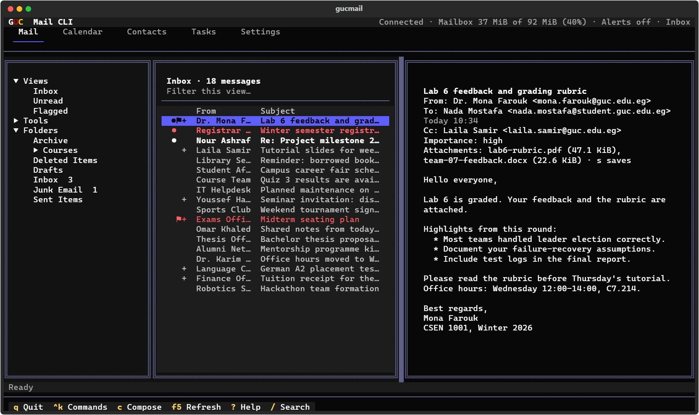
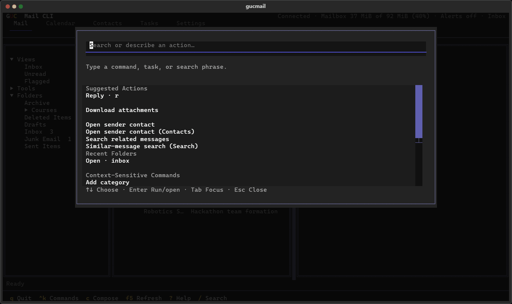
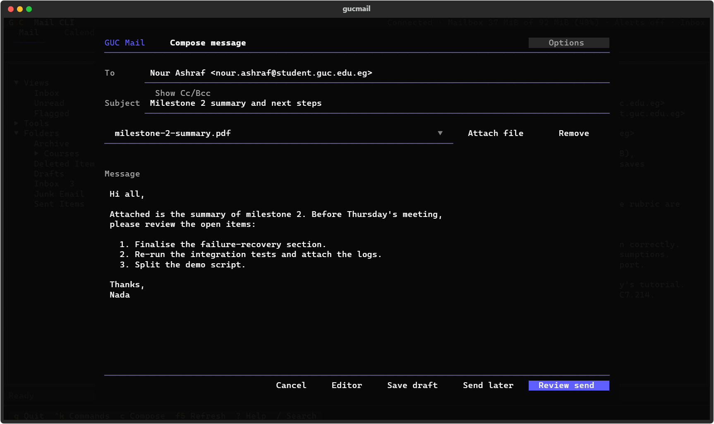
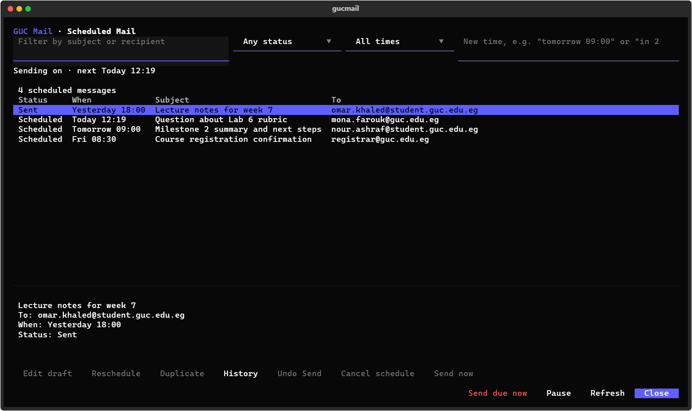
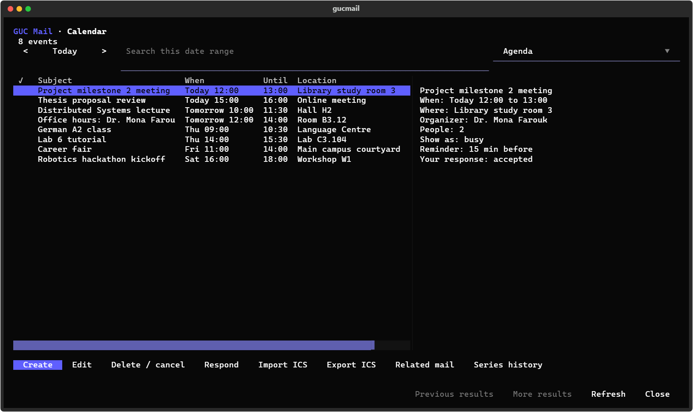
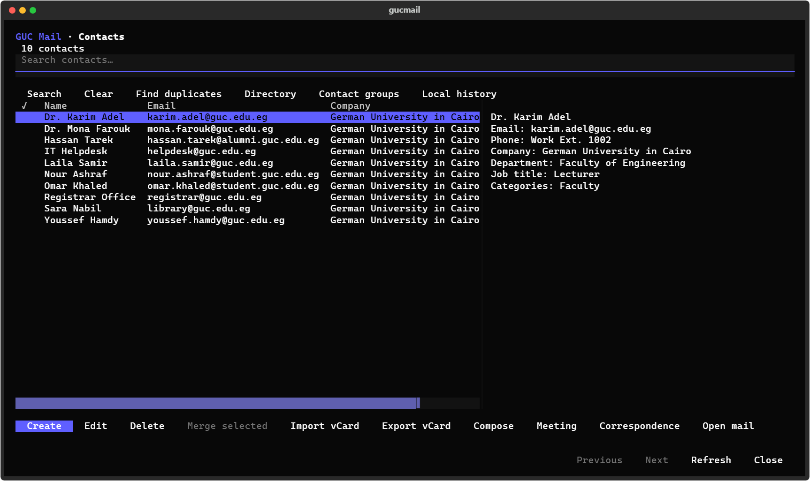
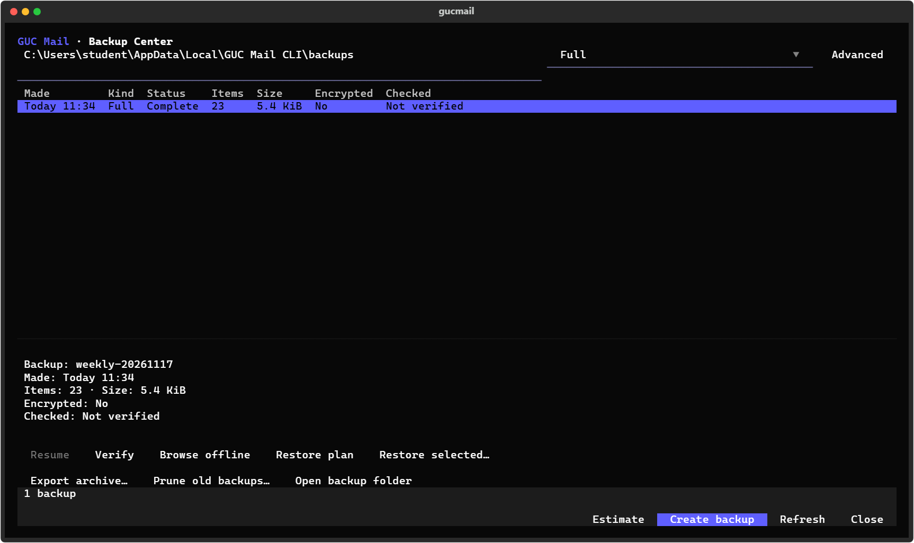

# gucmail

Your GUC mailbox, in a terminal. Read, write, search, schedule and back up your mail without
opening Outlook on the web. Calendar, contacts and tasks come along too. Everything works from
the keyboard, and everything is scriptable.



It talks directly to the GUC Exchange server through Exchange Web Services (EWS), the same
interface Outlook uses. There's nothing to install on the server and no third-party cloud in
between. Your password stays in Windows Credential Manager and your mail stays on your machine.
gucmail fetches headers in small pages, loads a message only when you open it, and keeps a
local cache and search index you can wipe at any time.

It was made for GUC, but nothing in it is GUC-only. It works with any Exchange server that
offers EWS with a username and password, which covers most on-premises Exchange 2013–2019
installations. Point it at yours with `gucmail config set endpoint https://mail.example.edu/EWS/Exchange.asmx`.
Microsoft 365 isn't supported, because it only allows OAuth sign-in.

*This is an independent project. I am not affiliated with the German University in Cairo or Microsoft.*

## Install

You need Python 3.11 or newer. [pipx](https://pipx.pypa.io) installs gucmail in its own
environment and puts the `gucmail` command on your PATH.

```powershell
py -m pip install --user pipx
py -m pipx ensurepath                 # then open a new terminal
pipx install "gucmail[desktop]"
gucmail                               # opens the app and asks you to sign in
```

The first time, gucmail shows one sign-in screen with your GUC email, your password and
**Test & save**. It checks them with the server and saves the password only if they work.
A short tour follows. `gucmail login` does the same from the terminal.

Update with `pipx upgrade gucmail`. Run `gucmail headless stop` first if mail alerts are on. Plain `pip install "gucmail[desktop]"` works too.
Leave out `[desktop]` if you don't want Windows notifications.

## Get around


Arrows move. **Enter** opens. **Tab** jumps between panes. **c** composes, **r** replies,
**/** searches and **?** shows every shortcut. Mouse and scroll wheel work too.

**d** deletes, **e** archives, **!** flags and **s** saves attachments. None of them ask
first, and **Ctrl+Z** undoes the last one.

**Ctrl+K** opens the command palette. Type what you want in plain words.



It shows what it understood and asks before it changes anything. It never guesses at deleting.

## Write



Reply, reply-all and forward. Cc and Bcc, attachments, signatures and importance. Recipients
autocomplete from your contacts and recent mail. It warns you about an empty subject, an
attachment you mentioned but forgot, or a typo in an address.

Drafts save themselves. If your laptop dies mid-sentence, the draft is waiting next time.
**Undo Send** holds a message for a few seconds before it leaves.

## Send later



```powershell
gucmail send --to laila.samir@guc.edu.eg --subject "Lab 6" --body-file report.txt --at "Monday 8:30"
gucmail send --to nada.mostafa@student.guc.edu.eg --subject "Reminder" --body "Submit thesis" --in "2 hours"
gucmail scheduled list
```

It shows the exact time and time zone before queuing, refuses ambiguous dates like `03/04`,
and never sends anything twice. Messages go out from your PC, so it needs to be on.
Turning on notifications also sends scheduled mail in the background.

## Calendar, contacts, tasks



Day, week, month and agenda views. Create events, accept or decline meetings, find a free
slot, catch clashes, and import or export `.ics` files.

| Contacts | Tasks |
|---|---|
|  |  |

Contacts find duplicates and merge them, and import and export vCards. Tasks have due dates,
progress and repeats.

## Search

```powershell
gucmail search --sender "dr. mona" --after 2026-10-01 --has-attachments
gucmail search "rubric" --all-folders
gucmail advanced index build --include-bodies    # build a local full-text index once…
gucmail search --local --fuzzy "gradng rubrik"   # …then search it offline, typos and all
```

Saved searches, per-folder or whole-mailbox scope, and a filter box in every view.

## Notifications, even with the terminal closed

In the app, press **Ctrl+K** and choose **Turn on notifications**. Or from the command line

```powershell
gucmail notifications on
```

That one step sets everything up. It registers gucmail with Windows, starts a small
background task that checks your Inbox about once a minute, and sends a test so you can see
it works. The task has no window, starts again when you sign in, and also sends your
scheduled messages on time. Clicking a notification opens the message.

```powershell
gucmail notifications status    # is it on, and is the background task running?
gucmail notifications off       # stop notifications (scheduled mail still goes out)
```

Rules, quiet hours and webhooks are optional, under **More** in notification settings.
[Details](https://github.com/aynader/gucmail/blob/main/docs/monitoring/headless-deployment.md).

## Backups you can read without a connection



```powershell
gucmail backup create --encrypt          # full backup, password-protected
gucmail backup incremental               # just what changed since
gucmail backup browse <id>               # read it offline, even with Wi-Fi off
gucmail tui --offline                    # or browse cached mail in the app
```

Backups never mark anything read and never change the server. Restores are planned first,
with exact counts, and you confirm before anything is written.

## Make it yours


More than 600 themes with live preview, and your own colours or logo. Choose your columns,
layouts and keyboard shortcuts in Settings, which you can search.


## Scripts and automation

Every command has `--json` (one envelope) or `--ndjson` (one record per line), stable exit
codes, `--yes` for confirmations and `--dry-run` for anything that changes mail.

```powershell
gucmail --json messages list --folder inbox --limit 5
gucmail --ndjson search --unread | ConvertFrom-Json | ? type -eq item | % { $_.data.subject }
gucmail --yes messages move msg_12 msg_13 --to "Courses/Distributed Systems"
gucmail quota                              # how full your mailbox is
gucmail doctor                             # checks everything, offline unless you ask
```

`gucmail --help` lists the everyday commands. `gucmail advanced --help` has the rest, such as
rules, automatic replies, insights, clustering and an EWS capability browser.

## Good to know

- Some features depend on what GUC lets your account do, such as the directory, free/busy,
  rules, delegates and quota limits. When the server says no, gucmail tells you so and never
  invents a value.
- It's tested on Windows 11 and Linux. macOS should work but isn't tested yet.
- More in the [user guide](https://github.com/aynader/gucmail/blob/main/docs/user-guide/index.md),
  [all commands](https://github.com/aynader/gucmail/blob/main/docs/command-reference/index.md),
  [troubleshooting](https://github.com/aynader/gucmail/blob/main/docs/troubleshooting/index.md)
  and [privacy and security](https://github.com/aynader/gucmail/blob/main/docs/privacy-and-security/index.md).

## Licence

MIT. See [LICENSE](https://github.com/aynader/gucmail/blob/main/LICENSE).
