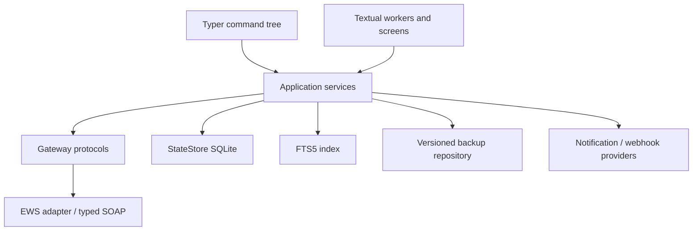
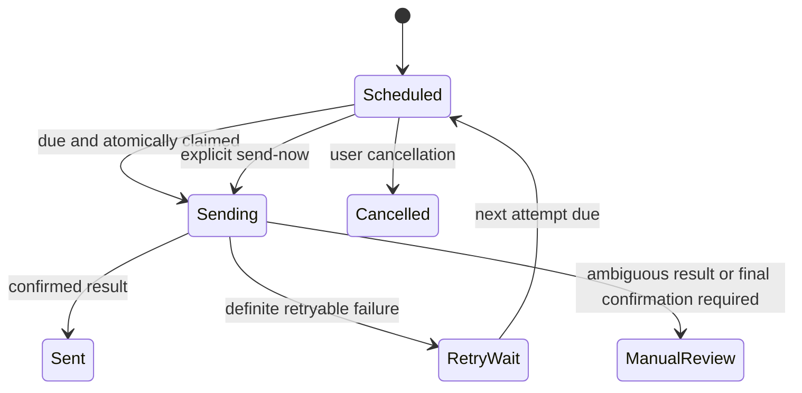

# Architecture

Palette parameter reviews receive the planner's actual confirmation requirement. Local-only
changes show Apply when the review itself is the final step; protected operations keep the
separate confirmation step. Parameter and allowlisted sequence review actions stay visible below scrollable content at compact
terminal sizes. Interpretation details identify local and Exchange effects from
command metadata rather than treating all mutations as changes to both.

SOAP request and response parsing disables entity resolution, DTD loading and network access.
Parsed document metadata also rejects DTD declarations regardless of input encoding; malformed
XML errors expose a fixed diagnostic rather than copying parser context from untrusted content.
Arbitrary raw execution remains unavailable and its legacy Settings entry cannot authorize it.

The repository is a layered Python package. UI modules parse and render; services own validation,
plans, state machines, and safety policy; adapters translate domain models to EWS; local stores own
durable SQLite and backup formats.

Optional tutorials live in `help/tutorials.py` with a thin Textual screen. Compose, command and
time exercises reuse shared validators/parsers without a gateway, command executor or delivery
provider. Progress uses the existing account-bound UI-preference store: one versioned record per
lesson, containing only position/completion. Storage errors fall back to session progress. The
practice text is not retained, and lesson completion carries no provider-verification meaning.

The TUI shares one thread-safe write coordinator across operational screens and
root mail/folder/composer/scheduling workers. A change reserves a lease before
execution; cancellation can release an unstarted reservation atomically. Once
its backend thread starts, only that thread's `finally` block releases the lease.
Closing a screen, a timeout or Textual worker cancellation therefore cannot
authorize a second change while the first request is still running. A blocked
action is rejected without queuing or replay, and composer recovery is saved
before the guard can reject a reviewed submission. Reads on other screens remain
available. This coordination covers one open TUI, rather than CLI processes or
other machines; service-level transactions, conflict checks and durable send
claims remain the authority for those boundaries.

## Scheduled-send state

Jobs, attachment manifests, attempts, backoff, and transition history are durable. Claims recover
after a crashed worker. Only one sender callback is invoked per claim; ambiguous mutation failures
do not receive an automatic duplicate retry.

## Backup and index

Backups use content-addressed immutable objects and versioned manifests. Partial directories are
resumable; complete directories are verified before browse/export/restore. The FTS database is a
separate disposable SQLite file with integrity and row-count verification.

## Trust boundaries

Windows desktop setup uses a shared preview/apply service for the CLI and TUI.
Its current-user registry adapter handles only exact owned identity/protocol keys;
unknown or changed state blocks changes. The optional native provider converts
sanitized domain events into SDK data and reports API acceptance separately from
visible display. Protocol activation has a dedicated `toast_entry` module, exact
account-bound local references and a read-only Textual reader. It does not route
activation text through the general CLI command parser. Desktop provider options
are non-secret SQLite metadata; credentials resolve only after activation checks.

Credentials resolve only when an online gateway is needed. Terminal/mailbox text is sanitized.
Attachment paths are contained and collision-aware. URLs and webhooks are checked against policy.
No import performs authentication or network I/O.

## Windows UI timer compatibility

With the supported Textual 7 release, Windows UI sleeps use cancellable asyncio timers
inside this process. No native wait or timer executor thread remains after cancellation.
Each sleep checks Textual's high-resolution clock before completing, so a coarse Windows
event-loop clock cannot make a timer fire before its requested deadline. After an early
wakeup it yields at least one Windows clock tick; animation timing can be less precise.
Other operating systems and future Textual major versions keep their existing behavior.
The adapter changes no installed dependency file or event-loop policy.

## Atomic disposable index replacement

CLI and Diagnostics rebuild share `SearchIndex.replace_many`. The service validates a bounded
replacement before a write transaction, then uses `BEGIN IMMEDIATE` and compares document count
plus the index update marker with a consistent preview revision. Same-count edits and other
processes therefore invalidate a stale replacement. Documents, FTS rows and the update marker
commit together; failures and cancellation observed before commit roll them back. Each owned
SQLite connection commits/rolls back and closes explicitly, including setup/read failures.

The 32 MiB replacement bound counts prepared UTF-8 field/payload data, not source buffers,
temporary serialization allocations or OS resident memory. Loading/validation occurs before
the short write transaction. This rebuild correction does not mutate the mailbox or migrate
the database schema.

`MailboxIndexProducer` is shared by CLI build/update/rebuild and Diagnostics rebuild. It reads
one effective current-machine attachment policy snapshot, then binds that policy to the review.
Attachment content remains disabled until saved consent and invocation confirmation are present.
Bounded streams feed isolated ordinary parsers or the separately enabled installed-language local
OCR service. Aggregate reports expose counts; private per-file labels/truncation persist in the
index payload. No watcher, background download, dependency install or mailbox mutation is added.
Diagnostics uses the same account/machine settings context as the mounted Settings area and CLI.

Notification profile rendering ignores unchanged and stale selector events. Rebuilding the
profile options therefore does not recursively inspect SQLite while idle; a genuine current
keyboard selection refreshes its configuration once.

Diagnostics results and previews use a focusable scroll pane. Tab and End expose complete
attachment counts, outcomes and policy text even in narrow terminals.

Notification configuration refresh and its local diagnostics report now collect repository
metadata in the shared read worker. UI rendering and provider-row highlights consume the
completed snapshot; highlights do not reopen SQLite. Read cancellation/timeout/close ignore
late snapshots and leave existing local configuration unchanged. The running SQLite call
may finish before cancellation is observed; storage cancellation is not claimed. Controls
that need the refreshed model are disabled while loading, and an explicit palette editor
intent waits for that snapshot. Cancel, error, timeout or Close clears a deferred intent.
Profile, rule, quiet-hours, digest, provider, route, webhook and import changes use the shared
write worker and application write lease. Closing, cancelling or timing out stops waiting;
the lease remains reserved until the real write completes. A cancelled write may already
have persisted, so another write is blocked until completion and the user must refresh.
Multi-repository changes retain their existing transaction boundaries; they are not newly
atomic across all profile/provider/secret-store writes. Errors expose no destination or
secret and do not automatically retry mutations.

Exports, provider-enable review and local simulation collect their repository data in read
workers. Profile/provider editors use the completed metadata snapshot. Export ignores a
result if the transfer input changed while reading. Webhook selection uses the snapshot;
the explicit synthetic delivery worker rechecks the selected definition and rejects changes
before delivery. Pure bounded import-document validation remains local presentation work.
Late read results are ignored; OS/database locking and real provider delivery are outside
this guarantee.

Calendar, Contact and Task editors share immediate visibility scrolling after layout,
including resize and recurrence-control changes. It avoids queued animated center scrolls
moving an earlier field into view after keyboard focus has already advanced.
Focus changes reveal the current field immediately and again after layout; ancestor scroll
animations are stopped explicitly, including scheduled scrolling that a no-distance reveal
would otherwise leave active. This is confined to form focus/layout changes, not a polling
loop that overrides deliberate scrolling.
Calendar repeat and attachment controls retain labels after their inputs are populated;
conditional recurrence labels follow the same visibility as their corresponding controls.

Theme preference and custom-definition writes use the same operational worker and app-wide
write lease as other workspaces. Apply, favorite, duplicate/create/edit/rename, import/export,
delete and reset collect input on the UI thread and perform local persistence in the worker.
Delete/reset recheck ownership after confirmation. Preview and cancel remain presentation work,
but wait while this appearance session is being changed. The screen keeps the exact success
message after refreshing its rows. Low-level storage failures expose only a safe error type.

The appearance screen refuses its Close action while its own write is unfinished. Cancelling
or timing out stops waiting without releasing a started write; forced screen removal also
leaves the lease with that worker. A completed config write can still commit afterward, and
runtime activation is marshalled to the app's UI thread even after the original screen is gone.
This does not add cancellation of filesystem calls, multi-file transactions or automatic retries.
Held synthetic writes, late confirmation, timeout, cancellation, unmount and failed persistence
verify these ownership and responsiveness boundaries without accessing Exchange or a provider.

Direct named-theme application from the command palette also uses a coordinated worker.
An app-owned appearance indicator protects the shared theme session across browser navigation
and the root palette worker; preview/cancel/close wait only for an appearance change, while
unrelated app writes can still allow read-only theme previews. The ordinary app-wide lease
continues to prevent overlapping persistent changes.

Branding Apply and the palette banner toggle use the same threaded write boundary.
An app-owned indicator keeps the shared branding preview stable while its write runs;
Cancel, Reset, Close and reopened browsers wait for the actual write thread. Cancellation,
timeout and forced screen removal stop UI waiting without releasing an active lease.
Completed branding activation returns to the UI thread. Cancel and Reset reconcile the
selected preset with the currently filtered table, so a later Apply uses the visible row.

Returning from either appearance browser refreshes a clean Settings view through its
existing read worker. Direct theme and banner palette writes also refresh an open Settings
view after persistence. Staged preferences are retained and receive specific guidance to
Cancel and Refresh before applying; the settings revision check still rejects stale edits.
