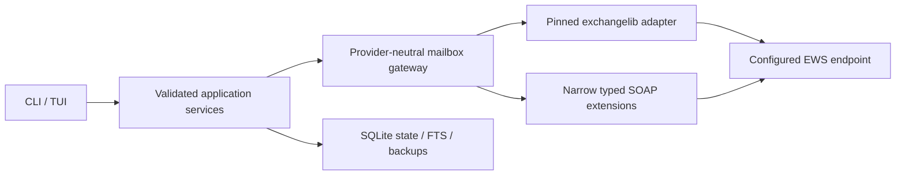

# Exchange Web Services boundary

The application uses a provider-neutral gateway. `exchangelib==5.6.0` supplies the primary typed
transport. A small SOAP module covers only classified gaps with fixed namespaces, serializer order,
response parsing, and fault handling. Domain models cross the boundary; `exchangelib` objects do
not.

Every operation records implementation path/status, server support, account access, verification,
safety class, minimum version, retry class, dry-run support, and fallback. HTTP success is not
treated as operation success when an EWS response message contains a fault.

Read-only retries may honor server backoff. Ambiguous send/update/delete failures are not blindly
retried. Lists are bounded and request explicit fields. Ordinary delete moves to Deleted Items;
hard delete requires a separate explicit path.

Use `gucmail ews support-matrix` or the [feature-by-feature operation matrix](operation-matrix.md)
for all 93 installed entries. The registry is complete for the
operation families intentionally considered by this product, including administrative families
that remain registry-only. It is not a claim that every operation in Microsoft's entire EWS schema
is a supported product workflow.

Arbitrary raw SOAP execution is unavailable in this release. Expert mode does not enable an
executor, and the unavailable Raw SOAP setting cannot authorize XML transmission.
`gucmail ews request-preview FindItem` classifies a named operation locally; it does not execute a request.
Use the registered typed commands for supported mailbox actions.

See [Support status](../features/support-status.md) and [Known server limitations](known-server-limitations.md).
